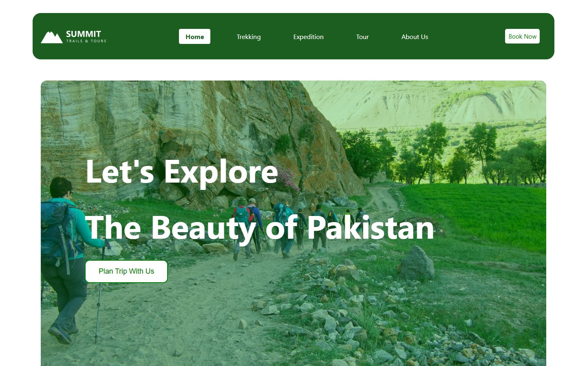
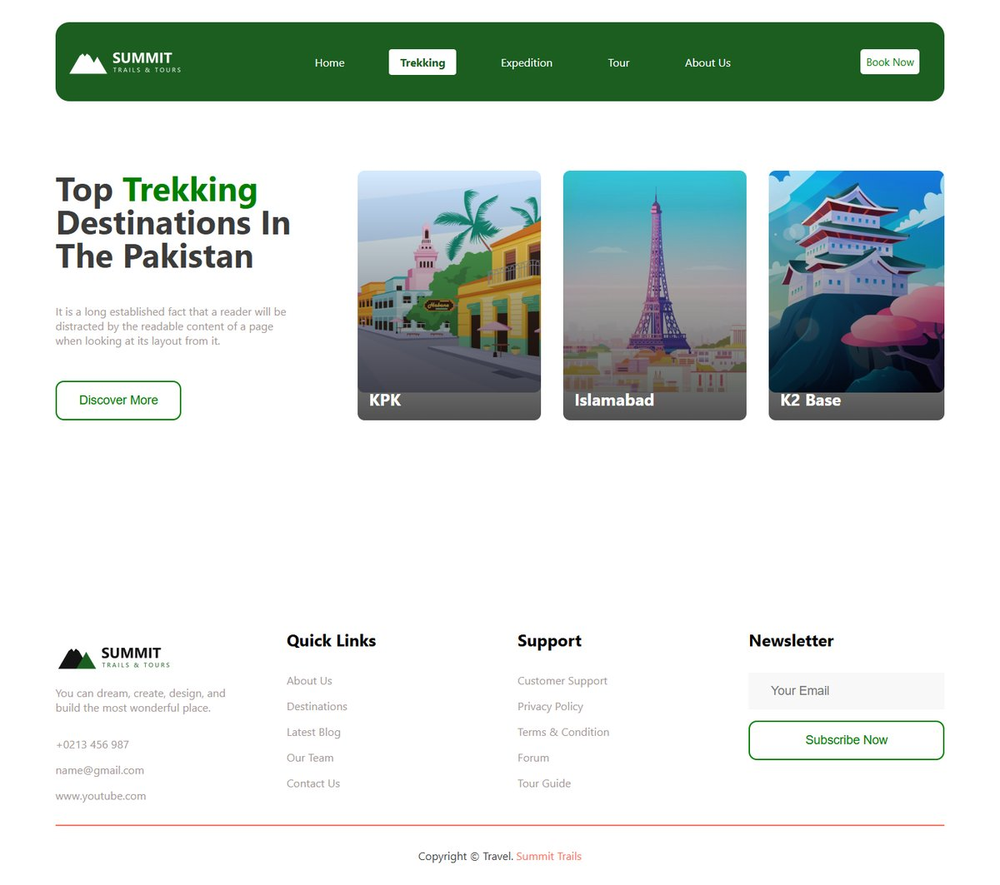
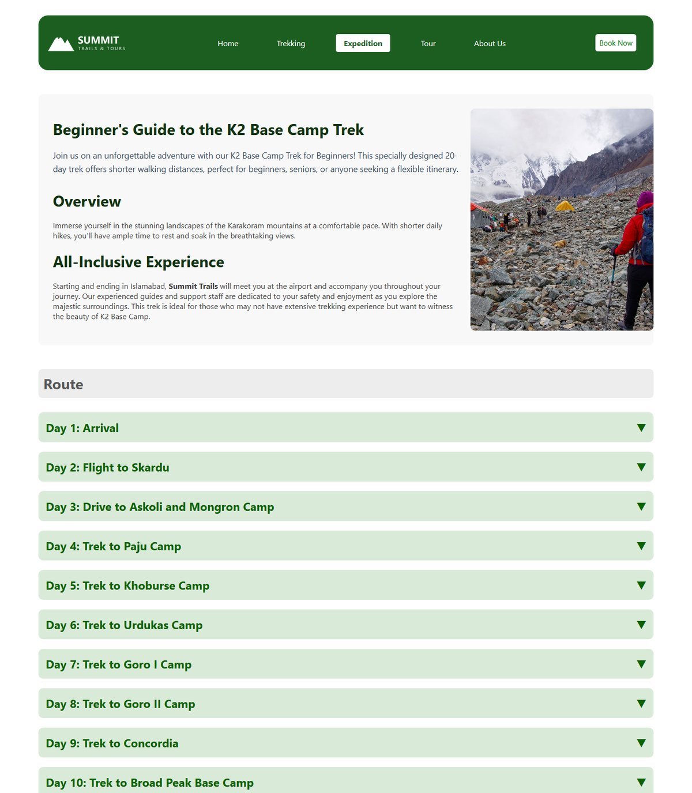
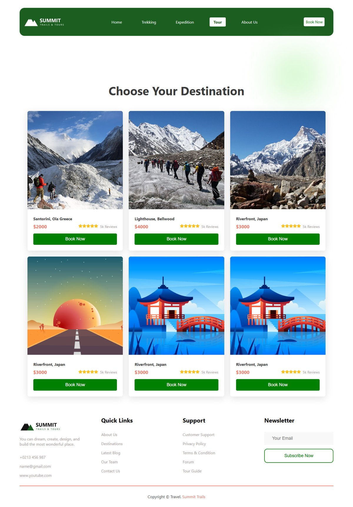
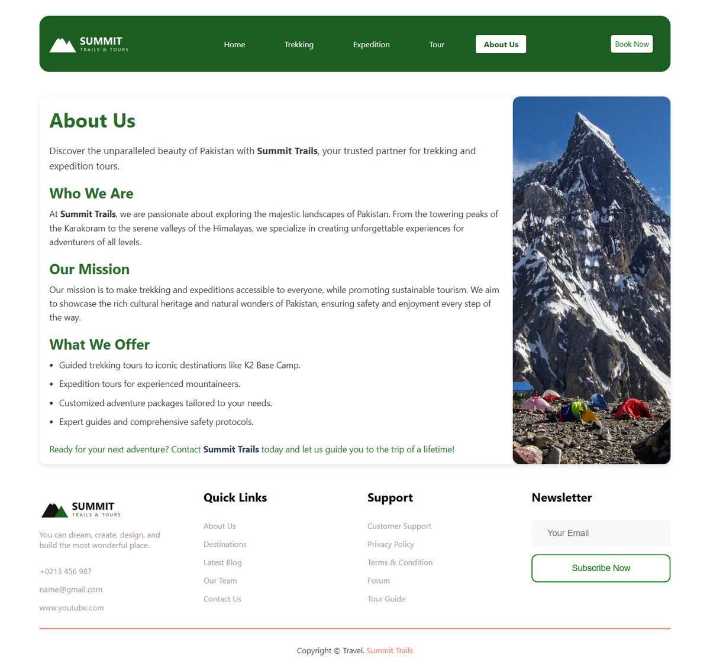
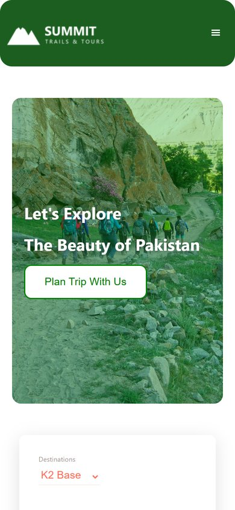
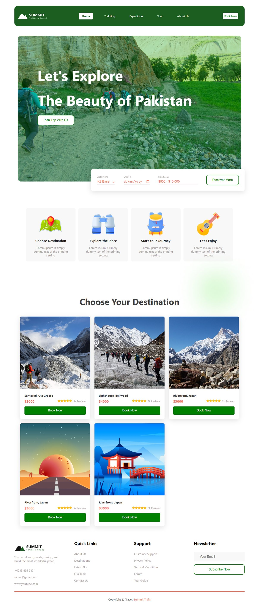

# Summit Trails: Travel & Tour Guide Website

A responsive, multi-page travel agency website for trekking and expedition tours in Pakistan, built with **React**, **React Router** and **styled-components**. It covers destinations, a full 19-day K2 Base Camp itinerary, tour packages and an About page.

**Live demo: [travel-tour-guide-website.vercel.app](https://travel-tour-guide-website.vercel.app)**



## Features

- **Five pages with client-side routing** (React Router): Home, Trekking, Expedition, Tour and About Us, with the active link highlighted in the navbar.
- **Trip planner bar** on the home page with destination, check-in date and price-range fields.
- **Expandable itinerary:** a day-by-day K2 Base Camp route (19 days) where each day opens to show details, followed by trip highlights and included services.
- **Reusable components:** tour cards take a `numberOfTours` prop, so the home page shows 5 and the Tour page shows 6, all from the same component.
- **Responsive design:** a hamburger menu and stacked layouts on screens narrower than 1080px.
- **Scroll-to-top button** that appears as you scroll down.
- **Component-scoped styling** with styled-components, plus plain CSS for the long-form pages.

## Screenshots

| Trekking destinations | Expedition itinerary |
|---|---|
|  |  |

| Tour packages | About us |
|---|---|
|  |  |

<p>
  
</p>

<details>
<summary>Full home page</summary>



</details>

## Tech stack

React 18 · React Router 6 · styled-components 6 · React Icons · Vite

## Getting started

You need [Node.js](https://nodejs.org/) 18 or newer.

```bash
git clone https://github.com/arslanahmedbhutto/travel-tour-guide-website.git
cd travel-tour-guide-website
npm install
npm run dev
```

Then open http://localhost:5173.

To make a production build:

```bash
npm run build     # outputs to dist/
npm run preview   # serves the production build locally
```

## Deployment

The site is deployed on [Vercel](https://vercel.com) (Framework preset: Vite, build command `npm run build`, output directory `dist`). `vercel.json` sends every route to `index.html`, so direct links and page refreshes on pages like `/tour` work with React Router.

## Project structure

```
travel-tour-guide-website/
├── index.html
├── vercel.json                # Route rewrites for client-side routing
├── public/
│   └── favicon.ico
├── src/
│   ├── main.jsx               # App entry point
│   ├── App.jsx                # Router and page layout
│   ├── index.css              # Global styles and CSS variables
│   ├── assets/                # Images and logos
│   └── components/
│       ├── Navbar.jsx         # Responsive navbar with active-link state
│       ├── Home.jsx           # Hero, trip planner, services and tours
│       ├── Services.jsx       # "How it works" cards
│       ├── Destinations.jsx   # Trekking destinations page
│       ├── Expeditions.jsx    # K2 Base Camp itinerary page
│       ├── Tours.jsx          # Tour package cards
│       ├── DownloadApp.jsx    # About Us page
│       ├── Testimonial.jsx    # Customer testimonial
│       ├── ScrollToTop.jsx    # Scroll-to-top button
│       ├── Button.jsx         # Shared button
│       └── Footer.jsx         # Links and newsletter signup
└── screenshots/
```

## Note

Summit Trails is a demo brand. The phone number, email and testimonial on the site are placeholders.
